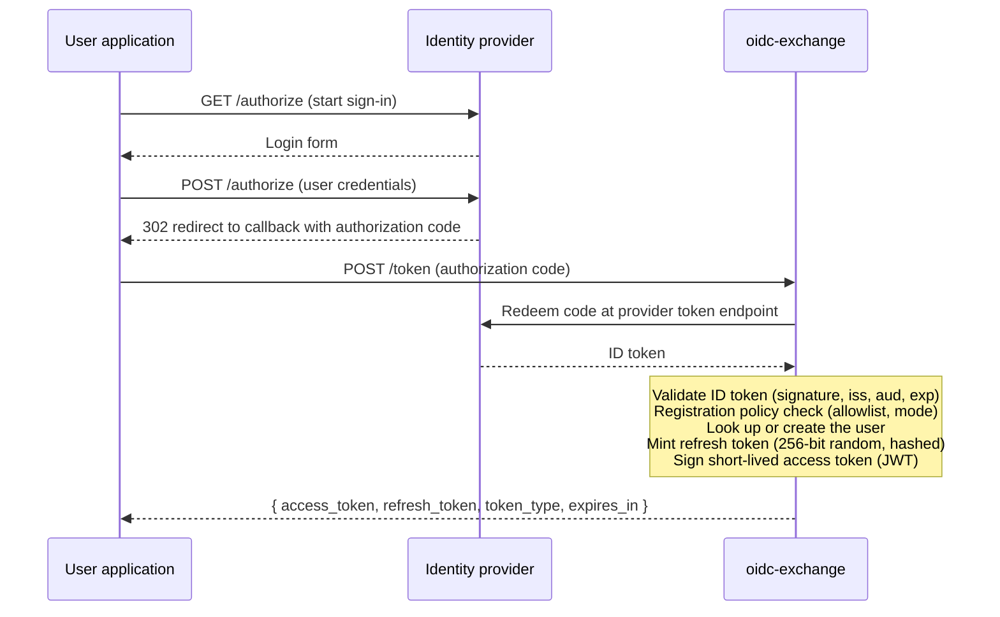

oidc-exchange is a Rust service that validates identity (ID) tokens from OpenID Connect (OIDC) providers such as Google and Apple. OIDC is an identity protocol built on OAuth 2.0. The service exchanges provider credentials for its own access and refresh tokens.

Your client application handles sign-in with the identity provider. It sends the resulting authorization code to oidc-exchange. The service validates the identity, finds or creates the user, and returns two tokens:

- An access token is a signed JSON Web Token (JWT) that your API uses to authorize requests.
- A refresh token lets the client obtain new access tokens without asking the user to sign in again.

## Token exchange flow

The diagram shows your application, the identity provider, and oidc-exchange.

1. The user selects "Sign In". Your application redirects them to the identity provider's authorization endpoint.
2. The user signs in with the provider.
3. The provider redirects the user back to your application's callback URL with an authorization code.
4. Your application sends the authorization code to `POST /token`. oidc-exchange redeems the code with the provider and validates the returned ID token's signature, issuer, audience, and expiry. It checks the registration policy and finds or creates the user.
5. oidc-exchange signs an access token and generates a random 256-bit refresh token. It stores only a hash of the refresh token.
6. The service returns `{ access_token, refresh_token, token_type, expires_in }`. Your application uses these credentials to complete sign-in.

The authorization-code grant is enabled by default. To accept provider ID tokens directly, set `[grants] id_token = true`. Each direct exchange must first obtain a nonce, a value used once to bind the exchange, from `POST /nonce`.

## Features

- **Token exchange:** Issue access tokens that expire after 15 minutes and refresh tokens that expire after 30 days by default.
- **Identity providers:** Configure standard OIDC providers such as Google. Use the Apple module for its specific requirements. Support for the non-OIDC provider atproto is planned.
- **Replaceable infrastructure:** Select database, key management, audit, and user synchronization adapters through configuration.
- **Registration policy:** Allow new users or restrict access to existing users. Optionally allow only specific email domains or subdomains.
- **Custom claims:** Add fields to access tokens through TOML configuration templates. Set per-user overrides through the internal API.
- **Audit logging:** Record security events with syslog severity levels. Send events to process output or Amazon Simple Queue Service (SQS). Configure which audit failures also fail the request.
- **OpenTelemetry:** Export traces through the OpenTelemetry Protocol (OTLP), AWS X-Ray, or standard output.
- **Written in Rust:** Run a native binary with low memory use and fast startup.
- **Server and Lambda support:** Run the same binary as an axum web server or an AWS Lambda function.
- **Docker images:** Deploy prebuilt images from `ghcr.io/antstanley/oidc-exchange`.
- **Node.js and Python bindings:** Embed the service in an existing application with `npm install @oidc-exchange/node` or `pip install oidc-exchange`.
- **Internal admin API:** Create, read, update, and delete users and manage their claims. Authenticate with an operator token or mutual Transport Layer Security (mTLS). Legacy shared-secret authentication is available but discouraged.

## Performance

oidc-exchange compiles to a native binary with no garbage collector and no interpreter to warm up, so it stays small and starts fast. Once your API has fetched and cached the signing keys, it validates every token with a local signature check, so there is no call to oidc-exchange or the identity provider on the request path.

These numbers are indicative. They were measured on an Apple M2 (macOS, arm64) with a release build, a SQLite repository, and local Ed25519 keys, and will vary with your hardware, storage, and configuration.

| Metric | Measured |
| --- | --- |
| Binary size | about 40 MB, a single file with every adapter compiled in |
| Idle memory | about 11 MB resident |
| Startup to first request | about 15 ms warm, about 110 ms on a cold start |
| Request overhead (`/health`, `/keys`) | about 1.4 ms median, under 2.5 ms at p99, over localhost |

The small footprint and sub-second startup suit serverless cold starts (AWS Lambda) and dense container packing.

## Next steps

- Follow the [Quick Start](/getting-started/quick-start/) to build and run the service.
- Read [Why oidc-exchange?](/getting-started/why-oidc-exchange/) to compare authentication approaches.
- Use the [deployment guides](/deployment/overview/) to choose your infrastructure.
