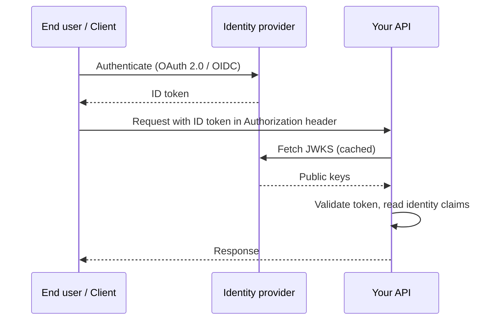
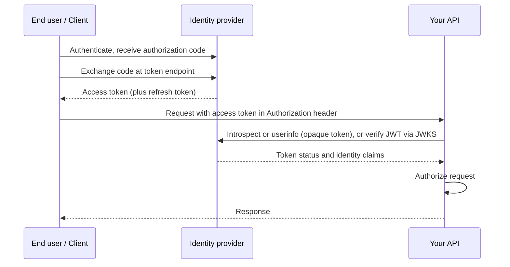
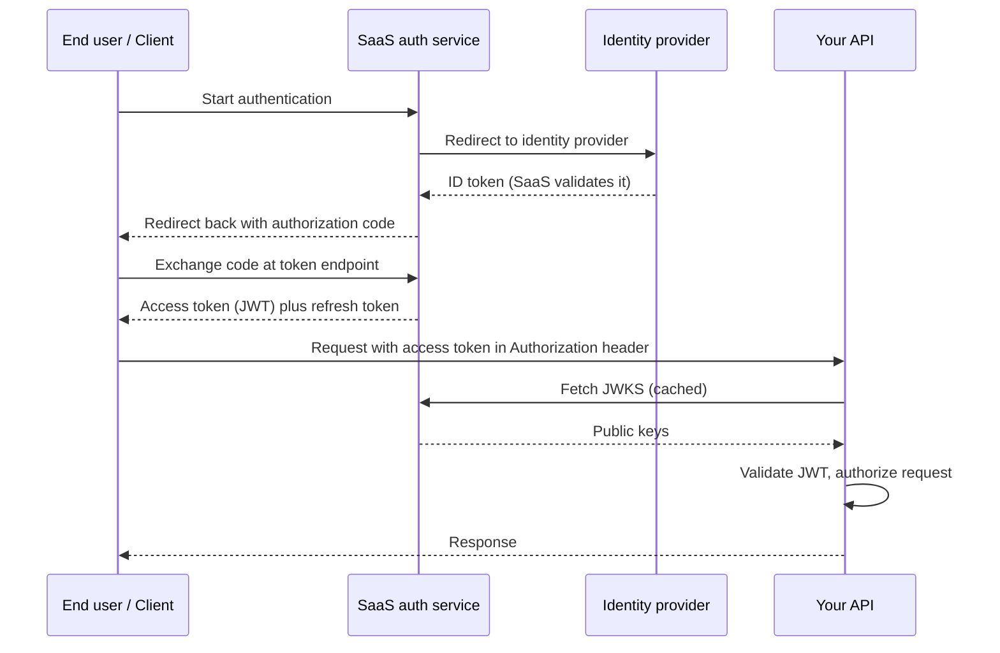
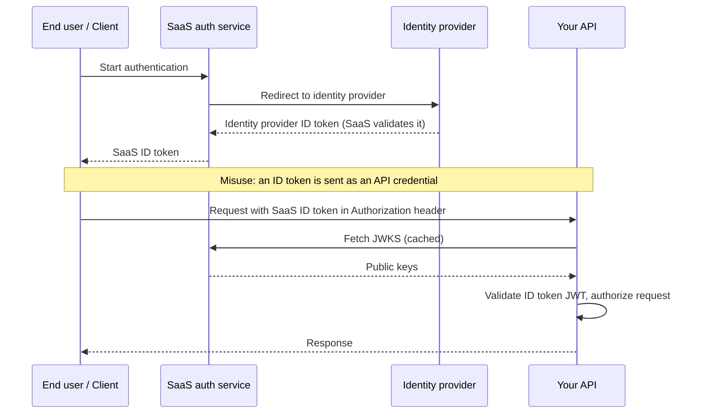
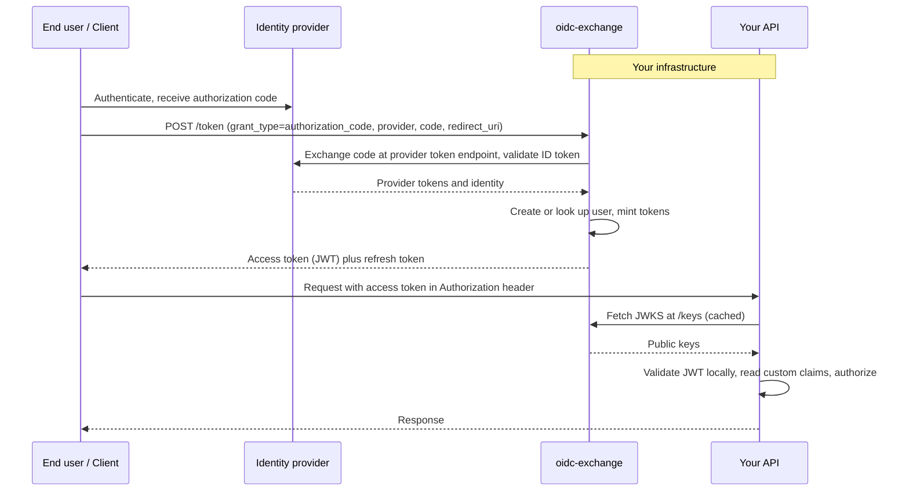

Applications that use Google, Apple, or another OpenID Connect (OIDC) provider need a way to authorize API requests after sign-in. OIDC is an identity protocol built on OAuth 2.0. Your choice of token service affects who controls tokens, what you operate, and which services must be available.

An identity (ID) token tells the client who signed in. An access token authorizes access to an API. A refresh token lets the client obtain new tokens.

## Common authentication architectures

### 1. Using identity provider ID tokens directly

The client signs in with the provider and sends the resulting ID token to your API in the `Authorization` header. Your API checks its signature, expiry, and audience. It obtains the provider's public keys from a JSON Web Key Set (JWKS).

**Pros:**

- You do not need a separate token exchange service.
- You can implement validation for a single provider with little infrastructure.

**Cons:**

- ID tokens describe identity for the client application. They are not intended as API access tokens.
- The provider controls token lifetime and claims, which are the fields in a token.
- Your API must obtain application roles and permissions separately.
- Your API must handle each provider's token format and validation rules.
- Your client depends on the provider's flow to obtain new tokens.

### 2. Using identity provider access tokens directly

The client sends the provider's access token to your API. Validation depends on the provider. It may require a call to an endpoint that checks token status or returns user information. If the access token is a JSON Web Token (JWT), validation may use the provider's public keys.

**Pros:**

- Provider refresh tokens can let users stay signed in longer.
- The provider's user information endpoint offers a standard way to retrieve identity claims.

**Cons:**

- Validation may require a provider request, which adds delay and a dependency on provider availability.
- Opaque tokens cannot be inspected and verified locally.
- Tokens contain the provider's claims rather than your application's roles and permissions.
- Provider requests are subject to rate limits.
- Each provider may require different validation logic.

### 3. SaaS auth service issuing its own tokens

A hosted authentication service, also called software as a service (SaaS), handles sign-in with the identity provider. Examples include Auth0, Cognito, Clerk, and Firebase Auth. The service issues its own access and refresh tokens. Your API validates signed tokens using the service's JWKS endpoint.

**Pros:**

- The service manages provider integrations, token issuance, and signing keys.
- You can configure custom claims, roles, and token lifetimes where supported.
- User management and admin interfaces can reduce development work.

**Cons:**

- Pricing may depend on monthly active users (MAU).
- Token configuration and user data become tied to the service, which adds migration work.
- Configuration and policy controls depend on the service's available tools.
- Sign-in depends on the service's availability and adds network requests.
- Some validation flows also require calls to the hosted service.

### 4. SaaS auth service using ID tokens for API authorization

The hosted service handles provider sign-in and issues an ID token. The client sends that token to your API, which validates it using the service's public keys.

ID tokens tell the client who signed in. Use access tokens to authorize API requests.

**Pros:**

- The service provides one token format across identity providers.
- Your API can check JWT signatures locally with cached public keys.

**Cons:**

- The token is intended for the client application rather than API authorization.
- An issued ID token generally remains valid until expiry.
- Your client depends on the hosted service to obtain new tokens.
- Identity claims do not replace application permissions.
- Hosted service costs still apply.

### 5. Issuing your own tokens with oidc-exchange

The client signs in with the identity provider and sends the authorization code to oidc-exchange. Direct ID-token exchange is optional and requires a nonce from `POST /nonce`. The service validates the identity, finds or creates the user, and issues its own access and refresh tokens. Your API checks access tokens locally using public keys cached from oidc-exchange's JWKS endpoint.

**Pros:**

- You configure access and refresh token lifetimes and can revoke refresh token sessions.
- You can include application roles, permissions, and metadata in access tokens.
- Your API validates one token format across identity providers.
- Local token validation does not require a request to an identity provider or hosted authentication service.
- You operate the service on your infrastructure without a per-user service fee.
- You can version configuration files with your code.
- You control the database and signing keys.

**Cons:**

- You must deploy, monitor, and maintain the service.
- The service does not provide OAuth 2.0 client credentials, scopes, consent screens, or organization management.
- Your client must implement the identity provider's sign-in redirect flow.

## Summary

| Approach | Application claims | Token lifetime control | One format across providers | Local signature validation |
|---|---|---|---|---|
| Provider ID tokens | Provider-controlled | Provider-controlled | No | Yes |
| Provider access tokens | Provider-controlled | Provider-controlled | No | Depends on token format |
| SaaS auth service | Depends on service | Depends on service | Yes | Depends on token format |
| SaaS ID tokens | Identity claims | Depends on service | Yes | Yes |
| **oidc-exchange** | **Yes** | **Yes** | **Yes** | **Yes** |

## When to use something else

oidc-exchange is not a general-purpose authorization server. Choose a different tool if you need:

- **Password authentication:** oidc-exchange delegates sign-in to identity providers.
- **A full OAuth 2.0 authorization server:** Issuing tokens to third-party clients with scopes and consent requires a full authorization server.
- **Organization management:** Applications that serve multiple organizations may need role-based access control (RBAC) or System for Cross-domain Identity Management (SCIM) for user provisioning.
- **Authentication between services:** Mutual Transport Layer Security (mTLS) or a workload identity system addresses this need.
